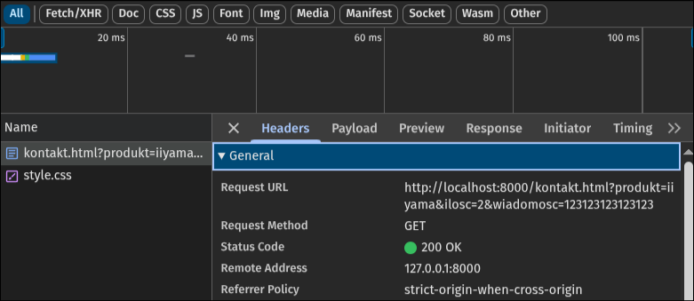

# Testy

User Agent przeglądarki:
```
Mozilla/5.0 (X11; Linux x86_64) AppleWebKit/537.36 (KHTML, like Gecko) Chrome/155.0.0.0 Safari/537.36

Chromium @ Fedora Linux
```


## 1. Nu HTML Checker

### Oczekiwany wynik:
- Brak błędów, kolejność nagłówków i treści po wyłączeniu CSS zgodna z HTML.

### Zaobserwowany wynik:
- jw.

#### Komentarz
Składnia HTML nie należy do tych skomplikowanych, Visual Studio Code radzi sobie bardzo dobrze z wyłapywaniem ewentualnych błędów w trakcie pisania kodu.

## 2. Widoki

### Oczekiwany wynik:
- 3 kolumny na ekranie szerokim, 1 kolumna na ekranie wąskim, formularz nie jest ucięty, obrazy zachowały proporcję, strona zachowuje się odpowiednio dla obu rozdzielczości.

### Zaobserwowany wynik:
- jw.

## 3. Kontrola klawiaturą

### Oczekiwany wynik:
- Fokus zaznaczony czerwonym obrysem, kolejność od góry do dołu, od lewej do prawej, kliknięcie enter poprawnie aktywuje powiązane pole formularza. Kliknięcie etykiety myszką wymusza focus na odpowiednim polu.

### Zaobserwowany wynik:
- jw.

## 4. Walidacja formularza

### Oczekiwany wynik:
- Pusty formularz nie przechodzi z błędem (przez pole `required` na znacznikach input).
- Formularz z błędnym mailem/liczbą poza zakresem/wiadomością krótszą niż 10 znaków nie przechodzi (walidowany przez przeglądarkę).

### Zaobserwowany wynik:
- Błędnie wypełniony oraz pusty formularz nie przechodzą, zostają zatrzymane przez przeglądarkę.
- URL: `http://localhost:8000/kontakt.html?email=mail%40test.com&produkt=gigabyte&ilosc=2&wiadomosc=moja+wiadomo%C5%9B%C4%87+dotycz%C4%85ca+produktu`
- Lista atrybutów:
    - `email = mail@test.com`
    - `produkt = gigabyte`
    - `ilosc = 2`
    - `wiadomosc = moja wiadomość dotycząca produktu`

## 5. Eksperyment

### Oczekiwany wynik:
- Usunięcie atrybutu `name` sprawi, że zniknie on z URL'a po wysłaniu żądania.

### Zaobserwowany wynik:
- jw. 

### Wyjaśnienie:
- Atrybut `name` służy do nadania klucza dla danej wartości. W URL'u widać, że ciąg znaków po ? jest zbiorem typu klucz-wartość, gdzie klucz jest właśnie atrybutem `name`.

